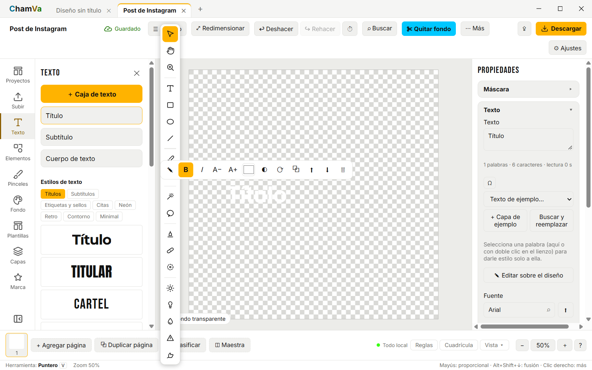

# Conector de Aplicativos Multimedia (ChamVa ↔ Krita ↔ Canva) 🚀

[](https://github.com/MaciasSM2/multiapp-connector)
[-brightgreen.svg)](https://github.com/MaciasSM2/multiapp-connector)
[](https://modelcontextprotocol.io/)
[](https://github.com/MaciasSM2/multiapp-connector)

Puente de interoperabilidad que permite a agentes de Inteligencia Artificial (**Antigravity**, **OpenCode**) controlar de forma directa y programática software de edición instalado localmente:

- **ChamVa**: Edición de video, máscaras ("Quitar fondo"), recortes y procesamiento FFmpeg de alta velocidad (Tauri 2 / WebView2).
- **Krita**: Ilustración digital profesional, lienzos de alta resolución, gestión de capas e importación de arte (PyKrita).
- **Canva**: Maquetación web y diseño gráfico en la nube con sesión persistente (Playwright).

---

## 🛠️ Arquitectura de Comunicación

El conector implementa el estándar oficial **Model Context Protocol (MCP)** sobre Python:

```text
[ Antigravity / OpenCode ]
         │  (Protocolo MCP - JSON-RPC stdio)
         ▼
[ server.py (MCPServer) ]
   ├── [ ChamVaAdapter ] ───► CDP Port 9333 ────► ChamVa (WebView2 / DOM)
   │                      └──► FFmpeg binario ──► Renderizado y corte local
   ├── [ KritaAdapter ]  ───► PyKrita Plugin  ──► Krita (Lienzo / Capas / Pinceles)
   ├── [ CanvaAdapter ]  ───► Playwright      ──► Canva Web (Perfil persistente)
   └── [ Orchestrator ]  ───► Flujos Cruzados entre aplicaciones
```

---

## 📦 Estructura del Proyecto

```text
Conector de aplicativos/
├── .venv/                      # Entorno virtual con Python 3.14 y dependencias
├── adapters/
│   ├── __init__.py
│   ├── chamva_adapter.py       # Controlador CDP y launcher para ChamVa
│   ├── krita_adapter.py        # Controlador HTTP y gestión de plugin para Krita
│   └── canva_adapter.py        # Controlador para Canva Web
├── plugins/
│   └── krita/                  # Plugin Python para PyKrita (%APPDATA%\krita\pykrita)
│       ├── kritapykrita_krita_bridge.desktop
│       └── krita_bridge/
│           ├── __init__.py
│           ├── krita_bridge.py # Extensión de Krita con cola de eventos Qt
│           └── server.py       # Servidor HTTP local (127.0.0.1:52150)
├── orchestrator.py             # Orquestador de flujos combinados multi-aplicación
├── output/                     # Capturas de pantalla, renders y exportaciones
├── cli.py                      # Herramienta de línea de comandos para control directo
├── demo_live_workflow.py       # Script de demostración integral validado
├── tests/
│   ├── test_all.py             # Pruebas unitarias básicas
│   └── test_verification_suite.py # Auditoría técnica de 14 puntos (100% aprobado)
├── opencode_mcp.json           # Configuración lista para OpenCode
├── config.py                   # Rutas y constantes del sistema
├── server.py                   # Servidor central MCP con 23 herramientas
├── requirements.txt            # Dependencias (mcp, playwright, httpx, etc.)
└── README.md                   # Documentación y configuración
```

---

## ⚡ Herramientas MCP Disponibles (23 Herramientas)

### 1. Diagnóstico y Sistema

| Herramienta | Descripción |
| :--- | :--- |
| `system_diagnostics` | Inspecciona el estado de instalación y ejecución de ChamVa, Krita y FFmpeg. |

### 2. Control de ChamVa

| Herramienta | Descripción |
| :--- | :--- |
| `chamva_status` | Comprueba si ChamVa está corriendo con el canal CDP activo (puerto 9333). |
| `chamva_launch` | Inicia ChamVa en segundo plano con depuración remota activada. |
| `chamva_screenshot` | Toma una captura visual de la ventana de ChamVa y guarda el PNG. |
| `chamva_create_design` | Abre un nuevo lienzo (presets: `instagram`, `story`, `youtube`, `facebook`, `custom`). |
| `chamva_open_video_editor` | Abre la línea de tiempo del editor de video. |
| `chamva_remove_background` | Ejecuta la herramienta de recorte/aislamiento 'Quitar fondo'. |
| `chamva_add_text` | Inserta bloques de texto en el diseño actual. |
| `chamva_export_design` | Descarga y guarda el diseño renderizado en la carpeta `output/`. |
| `chamva_ffmpeg_execute` | Ejecuta comandos directos en el motor FFmpeg verificado de ChamVa. |

### 3. Control de Krita

| Herramienta | Descripción |
| :--- | :--- |
| `krita_status` | Verifica si Krita está abierto y si el plugin KritaBridge está respondiendo (puerto 52150). |
| `krita_launch` | Inicia Krita en segundo plano con el puente KritaBridge activo. |
| `krita_document_info` | Obtiene información detallada del documento activo (dimensiones, capas, DPI). |
| `krita_create_document` | Crea un nuevo documento de dibujo en blanco (ancho, alto, nombre, DPI, modelo de color). |
| `krita_import_layer` | Importa una imagen externa como nueva capa en Krita. |
| `krita_add_layer` | Añade una nueva capa vacía en el documento activo. |
| `krita_export_canvas` | Renderiza y guarda el lienzo completo a PNG, JPG o PSD en disco. |
| `krita_trigger_action` | Dispara acciones nativas de Krita (deshacer, rehacer, deseleccionar, etc.). |

### 4. Control de Canva

| Herramienta | Descripción |
| :--- | :--- |
| `canva_open_session` | Abre Canva en el navegador con sesión persistente para diseño. |
| `canva_upload_asset` | Sube un archivo multimedia a la biblioteca de Canva. |

### 5. Flujos Cruzados (Pipelines Multi-App)

| Herramienta | Descripción |
| :--- | :--- |
| `pipeline_image_to_krita` | Inyecta una imagen local en Krita y deja una capa superior lista para dibujar encima. |
| `pipeline_video_trim` | Recorta un video a velocidad nativa sin pérdida de calidad con ChamVa FFmpeg. |
| `pipeline_video_frame_to_krita` | Extrae un fotograma clave de video y lo manda automáticamente a Krita como referencia de dibujo. |

---

## 🧪 Auditoría y Batería de Pruebas (14/14 Aprobado)

El proyecto incluye un runner de verificación técnica exhaustiva en `tests/test_verification_suite.py`:

```powershell
.\.venv\Scripts\python tests\test_verification_suite.py
```

Resultados de la auditoría:

- **ChamVa (Binarios, FFmpeg, CDP, Lienzo, Texto, Screenshot)**: 6/6 PASS
- **Krita (Binario, PyKrita, Sintaxis Qt)**: 3/3 PASS
- **Pipelines (Video sintético, Recorte stream-copy, Extracción de frame)**: 3/3 PASS
- **Servidor MCP (Catálogo de herramientas, Diagnóstico)**: 2/2 PASS
- **Total**: **14/14 superadas con éxito (100%)**.

---

## 🔌 Configuración en Antigravity y OpenCode

### En Google Antigravity

El servidor ya se encuentra automáticamente registrado en tu configuración global de Antigravity (`%USERPROFILE%\.gemini\config\mcp_config.json`):

```json
{
  "mcpServers": {
    "multiapp-connector": {
      "command": "c:\\Users\\Sebastian Macias\\Documents\\0. Programacion\\Conector de aplicativos\\.venv\\Scripts\\python.exe",
      "args": [
        "c:\\Users\\Sebastian Macias\\Documents\\0. Programacion\\Conector de aplicativos\\server.py"
      ],
      "env": {}
    }
  }
}
```

### En OpenCode

Usa el archivo [opencode_mcp.json](opencode_mcp.json) ya configurado en el proyecto:

```json
{
  "$schema": "https://opencode.ai/config.json",
  "mcp": {
    "multiapp-connector": {
      "type": "local",
      "command": [
        "c:\\Users\\Sebastian Macias\\Documents\\0. Programacion\\Conector de aplicativos\\.venv\\Scripts\\python.exe",
        "c:\\Users\\Sebastian Macias\\Documents\\0. Programacion\\Conector de aplicativos\\server.py"
      ]
    }
  }
}
```

---

## 💻 Control Directo por Consola (CLI)

También puedes controlar las herramientas directamente desde la consola con [cli.py](cli.py):

```powershell
# Diagnóstico general
.\.venv\Scripts\python cli.py status

# Crear un diseño en ChamVa
.\.venv\Scripts\python cli.py chamva-design --preset instagram

# Insertar texto en el diseño
.\.venv\Scripts\python cli.py chamva-text "Mi Proyecto AI"

# Capturar pantalla de ChamVa
.\.venv\Scripts\python cli.py chamva-shot

# Crear lienzo en Krita
.\.venv\Scripts\python cli.py krita-canvas --name "Ilustracion" --width 1920 --height 1080

# Inyectar imagen a Krita
.\.venv\Scripts\python cli.py pipe-to-krita "ruta\a\imagen.png"

# Recorte ultrarrápido de video con motor ChamVa
.\.venv\Scripts\python cli.py video-trim "ruta\video.mp4" --start 00:00:00 --duration 00:00:10
```

---

## 📸 Demostración Visual en ChamVa

Captura real tomada por el agente durante la automatización de creación de proyecto y diseño en ChamVa:



---

## 📝 Notas de la Versión (v1.1.0)

- **Auditoría Técnica Completa**: Suite de pruebas con 14 verificaciones automatizadas superadas al 100%.
- **Soporte de Aceleración por Hardware**: Uso del codificador nativo `h264_mf` (Windows MediaFoundation) para procesamiento multimedia en ChamVa FFmpeg sin dependencias de terceros.
- **Tolerancia a Superposiciones**: Manejo automático de modales y cierres de `.home-overlay` en la interfaz de ChamVa.
- **Limpieza de Bloqueos en Krita**: Detección y eliminación automática de archivos huérfanos `qtsingleapp-lockfile`.
- **Compatibilidad Ampliada**: Soporte directo y validado para **Antigravity IDE** y **OpenCode**.

---

## 📄 Licencia

Este proyecto se distribuye bajo la licencia **MIT**. Consulta el código fuente para más detalles.
